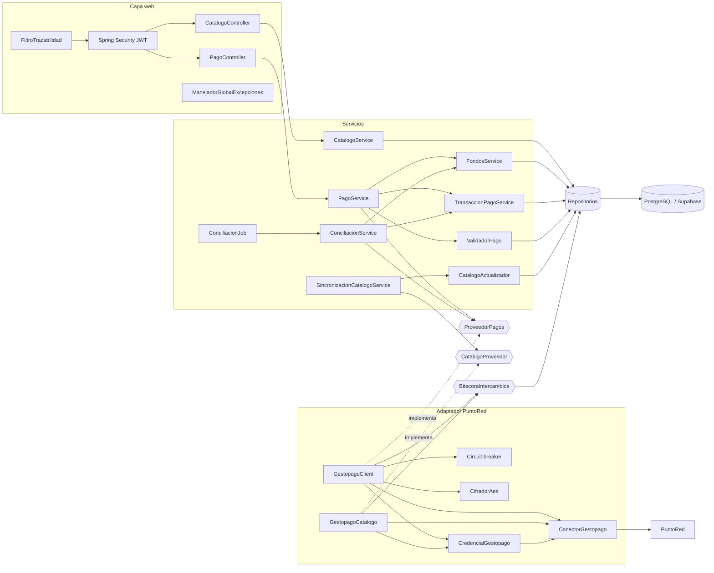
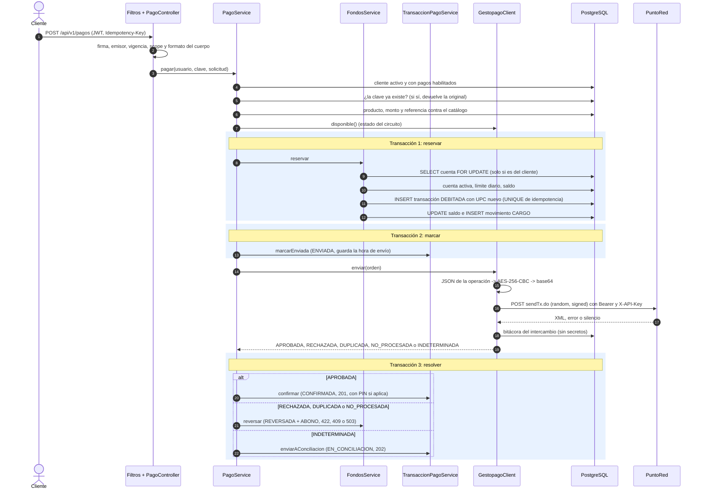
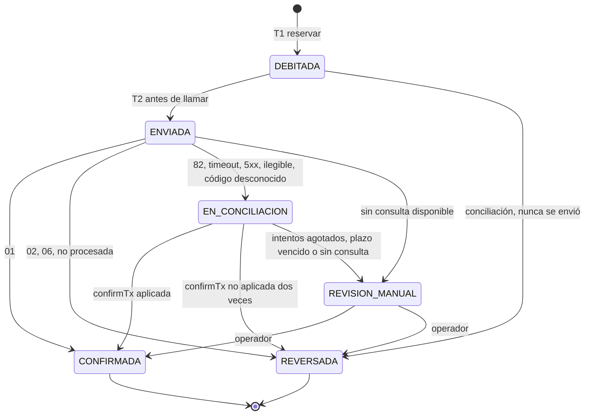

# Diseño de la integración de pagos de servicios con PuntoRed (GestoPago)

**Asignatura:** Aplicaciones Web Progresivas — Integración de pagos de servicios
**Endpoint del proveedor:** `POST https://gestopago.portalventas.net/sistema/service/sendTx.do` (autenticación Bearer)

Este documento explica **qué riesgos tiene la operación**, **cómo falla** y **por qué** el sistema está construido como está. Cada decisión indica la alternativa que se descartó y el motivo.

---

## 1. El problema

Pagar un servicio parece sencillo: descontar dinero y llamar al proveedor. Lo difícil son los casos en que algo sale mal a la mitad.

- Hay **dos sistemas de registro**: nuestra base de datos (el saldo) y PuntoRed (el pago del servicio). No existe una transacción que abarque ambos, así que en algún momento uno sabe algo que el otro no.
- La red es **ambigua**. Si la llamada se interrumpe por timeout, no hay forma de saber si el proveedor procesó la operación. Reintentar puede cobrar dos veces. Devolver el dinero puede regalar el servicio.
- Los clientes **reintentan**: doble clic, apps que reenvían al perder la conexión, peticiones simultáneas desde dos dispositivos.

Todo el diseño parte de una regla: **ante la duda, el dinero se retiene y se averigua; nunca se adivina.**

---

## 2. El contrato real de PuntoRed

La documentación técnica del proveedor (colección de Postman "PuntoRed API Technical Specification") define:

| Operación | Llamada | Formato |
|---|---|---|
| Autenticación | `POST /sistema/app/jwt-gp/authenticate/` con `idDistribuidor`, `codigoDispositivo`, `password` | Respuesta JSON `{"token": "...", "success": true}`. El token dura **24 h** y se debe tomar **uno por día**. |
| Venta o pago | `POST /sistema/service/sendTx.do`, `Authorization: Bearer`, `X-API-Key` opcional | Formulario `application/x-www-form-urlencoded` con `random` (cadena distinta por petición) y `signed` (JSON de la operación cifrado con **AES-256-CBC**, PKCS5, llave e IV del proveedor, en base64). Respuesta **XML**. |
| Confirmación | `confirmTx`, tras un `82` o un timeout | Indica si la operación quedó **aplicada** o **no aplicada**. Solo responde durante 24 h. |
| Catálogo | `GET /sistema/service/getProductList.do` | XML con servicios y productos. **Una vez al día, máximo 3 llamadas.** No debe usarse como fuente en línea. |

JSON de la operación (dentro de `signed`): `idProducto` e `idServicio` (enteros del catálogo), `telefono` (recargas), `referencia` y `montoPago` (pagos de servicio), `horaLocal` (`yyyyMMddHHmmss`), `upc` (identificador único de 3 a 15 caracteres que genera el integrador) y `unidad`.

Códigos (`MENSAJE/CODIGO`): `01` aplicada; `02` saldo insuficiente del distribuidor; `06` duplicada (ya se aplicó una operación igual; reintentar en 15 min); `82` el carrier no respondió en 62 s, hay que usar `confirmTx`; HTTP `403` con `"token": "EXPIRED"`, token vencido.

El proveedor también exige **guardar el registro de todas las peticiones y respuestas** y **entregar al cliente el PIN y la leyenda** de las tarjetas de regalo.

---

## 3. Arquitectura



| Paquete | Responsabilidad |
|---|---|
| `web` | Recibir HTTP, validar el formato (DTO + Bean Validation), traducir resultados y errores a HTTP. Sin lógica de negocio. |
| `seguridad` | Autenticación JWT, emisión de tokens, formato de los errores 401/403. |
| `servicio` | Orquestar el pago, mover dinero en transacciones cortas, conciliar, sincronizar el catálogo. |
| `dominio` | Entidades con sus reglas: la cuenta no se sobregira, el producto valida su monto, la transacción solo cambia de estado por transiciones válidas, el UPC tiene el formato del proveedor. |
| `repositorio` | Acceso a datos (JPA y JDBC), bloqueos, consultas de conciliación, bitácora. |
| `proveedor` | Puertos (`ProveedorPagos`, `CatalogoProveedor`, `BitacoraIntercambios`) y el adaptador de PuntoRed. Toda la incertidumbre de la red, el cifrado y el XML se resuelven aquí. |

### Principios SOLID aplicados

| Principio | Dónde |
|---|---|
| **S** — Responsabilidad única | `PagoService` orquesta; `FondosService` mueve dinero; `TransaccionPagoService` cambia estados; `ConectorGestopago` habla HTTP; `CifradorAes` cifra; `DocumentoXml` lee XML de forma segura; `CodigosGestopago` interpreta códigos; `ClasificadorFallos` interpreta excepciones de red; `ManejadorGlobalExcepciones` traduce a HTTP. |
| **O** — Abierto/cerrado | Un código nuevo del proveedor se agrega en `application.yml` sin tocar código. Otro proveedor de pagos es otra implementación de `ProveedorPagos`. La forma de obtener el token es una estrategia (`TokenEstatico` / `TokenRenovable`). |
| **L** — Sustitución de Liskov | Cualquier `ProveedorPagos` cumple el mismo contrato: no lanza excepciones por fallos esperados, devuelve un desenlace. Los dobles de prueba lo respetan. |
| **I** — Segregación de interfaces | El catálogo es un puerto aparte (`CatalogoProveedor`): tiene otro ritmo y sus fallos no deben afectar el cobro. `ProveedorPagos` expone solo `disponible`, `enviar` y `consultar`. |
| **D** — Inversión de dependencias | Los servicios dependen de interfaces, no de PuntoRed. Todas las dependencias se inyectan por constructor, incluido el reloj (`Clock`), lo que permite probar con dobles. |

---

## 4. Flujo completo de un pago



Las validaciones baratas y sin bloqueo (formato, idempotencia, catálogo, circuito) van **antes** de tocar la cuenta. Una solicitud inválida nunca llega a bloquear nada.

---

## 5. Máquina de estados



| Estado | Significado | ¿Dónde está el dinero? |
|---|---|---|
| `DEBITADA` | Descontado, **todavía no se envía**. | Retenido. Es seguro devolverlo sin consultar. |
| `ENVIADA` | Se va a enviar o ya se envió; aún sin respuesta. | Retenido. Solo el proveedor sabe qué pasó. |
| `EN_CONCILIACION` | El proveedor no dio una respuesta concluyente. **No es un fallo.** | Retenido mientras se consulta. |
| `REVISION_MANUAL` | La conciliación automática no pudo resolverla. | Retenido hasta que decida una persona. |
| `CONFIRMADA` | El proveedor confirmó el pago. | Cobrado. |
| `REVERSADA` | El pago no se realizó. | Devuelto, con su movimiento `ABONO`. |

**Invariante clave.** `ENVIADA` se guarda **antes** de llamar al proveedor. Así, una transacción en `DEBITADA` significa con certeza que *nunca se envió*, y la conciliación puede devolver el dinero sin preguntar.

Las transiciones válidas están en `EstadoTransaccion.puedeTransicionarA`. Un error de programación no puede, por ejemplo, reversar un pago ya confirmado: la entidad lanza excepción y la transacción de base de datos se revierte.

---

## 6. Decisiones de diseño

### D1. Descontar el saldo antes de llamar al proveedor

**Decisión.** Primero se descuenta y se registra la transacción (`DEBITADA`). Después se llama a PuntoRed.

**Alternativa descartada: llamar primero y descontar después.** Si el proveedor aprueba y el descuento falla (sin saldo porque otra operación lo consumió, la base cae, el proceso muere), el banco pagó un servicio que el cliente nunca cubrió, y no hay manera de recuperarlo.

**Consecuencia.** El peor caso de la opción elegida es que el dinero quede *retenido* un tiempo mientras se averigua el resultado. Es recuperable y auditable. El peor caso de la alternativa es una pérdida.

### D2. Tres transacciones cortas y la llamada HTTP fuera de todas

**Decisión.** `PagoService.pagar` **no** es `@Transactional`. Usa tres transacciones de base de datos de milisegundos (reservar, marcar enviada, resolver) y la llamada al proveedor ocurre fuera de todas.

**Alternativa descartada: una sola transacción que incluya la llamada.** Mantendría el bloqueo de la cuenta y una conexión del pool abiertos hasta 70 s por pago. Con unas cuantas operaciones lentas se agota el pool (en Supabase, además, el pooler admite pocas conexiones) y la API deja de responder. Peor aún: si el proveedor aprueba y luego la transacción se revierte, el proveedor cobró y nuestro registro desapareció.

**Consecuencia.** Entre transacciones el proceso puede morir. Por eso cada paso deja un estado persistido que dice qué hacer después (ver la invariante de la sección 5).

Los métodos transaccionales están en clases distintas (`FondosService`, `TransaccionPagoService`, `CatalogoActualizador`) porque `@Transactional` funciona por proxy. Una llamada interna dentro de la misma clase no pasaría por él.

### D3. Bloqueo pesimista de la cuenta

**Decisión.** La cuenta se lee con `SELECT … FOR UPDATE` (`@Lock(PESSIMISTIC_WRITE)`), filtrando por número **y** por cliente. Saldo, estado y límite diario se validan con el bloqueo tomado.

**Sin bloqueo:** dos peticiones leen saldo 100, ambas concluyen que alcanza para pagar 100 y ambas descuentan.

**Alternativa considerada: bloqueo optimista (`@Version`) con reintentos.** Es mejor cuando los conflictos son raros. Aquí el conflicto típico es la misma cuenta pagando varias cosas a la vez, y reintentar obliga a repetir todas las validaciones. El pesimista serializa de forma simple y predecible. Además se conserva `@Version` en la entidad como segunda red.

**Detalles.**
- Filtrar por cliente en la misma consulta evita que alguien bloquee cuentas ajenas solo con conocer su número.
- `lock_timeout = 3s` (configurado en la conexión): una espera más larga falla rápido con `409 OPERACION_CONCURRENTE` en vez de acumular hilos bloqueados.
- `CHECK (saldo >= 0)` en la tabla es la **última línea de defensa**.

### D4. Idempotencia: clave + huella + UNIQUE en base de datos

**Decisión.** Cada pago exige el encabezado `Idempotency-Key` (idealmente un UUID generado por el cliente).

1. **Camino rápido.** Si la clave ya existe para el cliente, no se ejecuta nada y se devuelve la operación original (`200` + `Idempotent-Replayed: true`, o `202` si sigue pendiente).
2. **Huella.** Se guarda el SHA-256 de los parámetros normalizados. Reutilizar la clave con otros datos responde `409 CLAVE_IDEMPOTENCIA_REUTILIZADA`.
3. **Garantía dura.** `UNIQUE (cliente_id, clave_idempotencia)`. Si dos peticiones pasan el camino rápido a la vez, la segunda choca con el `UNIQUE`, su transacción se revierte **sin haber tocado el saldo** y recibe la operación de la primera.
4. **En curso.** Si la original aún no termina, la repetición recibe `409 PAGO_EN_PROCESO` con el `transaccionId`.

**Una validación fallida no consume la clave.** Si el pago se rechaza por saldo insuficiente, la transacción 1 se revierte completa.

**Alternativa descartada: verificar duplicados solo en código.** Tiene ventana de carrera.

### D5. Clasificación de los resultados del proveedor

El adaptador nunca lanza excepciones al servicio por fallos esperados. Los traduce a un desenlace:

| Situación | Desenlace | Razonamiento |
|---|---|---|
| Código `01` | `APROBADA` | Confirmación explícita. Se guardan `ID_TX`, `NUM_AUTORIZACION` y, si viene, el PIN. |
| Código `02` (saldo insuficiente del distribuidor) | `RECHAZADA` | El proveedor evaluó y no aplicó (`NUM_AUTORIZACION = -1`). |
| Código `06` en el primer envío | `DUPLICADA` | Ver D6. |
| Código `06` tras repetir por token vencido | `INDETERMINADA` | Podría referirse al primer envío de este mismo UPC. |
| Código `82` | `INDETERMINADA` | El carrier no respondió: la documentación pide `confirmTx`. |
| **Código desconocido** | `INDETERMINADA` | Ver D8. |
| Circuito abierto | `NO_PROCESADA` | La llamada no se hizo. |
| Conexión rechazada, **timeout de conexión**, host desconocido, fallo de handshake TLS | `NO_PROCESADA` | La conexión nunca se estableció: el cuerpo HTTP no salió. |
| Sin credencial, o la orden no se pudo armar (producto sin identificadores del proveedor) | `NO_PROCESADA` | No se llegó a llamar a `sendTx`. |
| HTTP 401/403 | Se repite **una vez** con token nuevo; si persiste, `NO_PROCESADA` | El proveedor rechazó la credencial antes de procesar (ver D6). |
| Otros 4xx (400, 404, 422…) | `NO_PROCESADA` | Un 4xx indica que la petición no se cumplió. |
| HTTP 409 | `INDETERMINADA` | Puede significar "ya tengo una operación así". |
| HTTP 5xx | `INDETERMINADA` | Un 500 puede ocurrir **después** de aplicar el cargo. |
| **Timeout de lectura** | `INDETERMINADA` | La petición llegó; la respuesta no. |
| Conexión cortada a mitad de la respuesta | `INDETERMINADA` | Igual que el anterior. |
| Respuesta que no es XML, sin `CODIGO` o enorme (> 64 KB) | `INDETERMINADA` | No hay forma de saber qué dijo el proveedor. |
| Excepción inesperada en el adaptador (bug) | `INDETERMINADA` | Un error nuestro no prueba que el proveedor no cobró. |

`NO_PROCESADA` devuelve el dinero de inmediato (`503`). `RECHAZADA` también lo devuelve (`422`) y `DUPLICADA` igual (`409 PAGO_DUPLICADO`). `INDETERMINADA` lo **retiene** y la transacción pasa a conciliación (`202`).

**El costo de equivocarse no es simétrico.** Tratar como indeterminado algo que no se procesó solo retrasa la devolución hasta la conciliación. Tratar como no procesado algo que sí se procesó le regala el servicio al cliente. Por eso, ante la duda, siempre se elige indeterminado.

**Timeouts.** Conexión 5 s y lectura **70 s**. La lectura supera los 62 s que PuntoRed espera al carrier antes de contestar `82`: cortar antes convertiría en "dudosa" una operación que sí iba a tener respuesta. El cliente HTTP es el del JDK forzado a HTTP/1.1 (el endpoint `.do` es un servidor clásico) y **no reintenta POST por su cuenta**.

### D6. El UPC y la única repetición permitida

**UPC.** Cada transacción genera al reservarse un UPC de **15 dígitos aleatorios** (`GeneradorUpc`, `SecureRandom`), guardado en `referencia_externa` con `UNIQUE`. Es el identificador con el que PuntoRed detecta duplicados y responde `confirmTx`.
- *Por qué aleatorio y no un consecutivo:* varios ambientes (la base local, Supabase, otros equipos) usan las mismas credenciales de prueba del proveedor. Con contadores, todos empezarían en 1 y el proveedor rechazaría como duplicadas operaciones distintas.
- *Por qué solo dígitos y sin cero inicial:* es el formato que acepta cualquier validación y no se altera si el proveedor lo trata como número.

**Nunca reintentar `sendTx` a ciegas.** Reintentar una operación cuyo resultado se desconoce es la forma clásica de cobrar dos veces. La conciliación **pregunta** (D7); no reenvía.

**La excepción: 401/403.** Un token vencido (`403 "EXPIRED"`) se rechaza antes de procesar nada. Si la credencial es renovable, se descarta el token, se obtiene uno nuevo y se repite **una sola vez** exactamente la misma operación (mismo UPC, mismo `signed`). Si el proveedor ya la hubiera registrado, su detección de duplicados por UPC lo protege, y un `06` en esa repetición se trata como indeterminado.

**El 06.** PuntoRed rechaza una operación idéntica a otra aplicada en los últimos 15 min (recargas) o 24 h (servicios). Como cada pago propio lleva un UPC nuevo que nunca se reenvía, un `06` en el primer envío significa que **esta** operación no se aplicó: la otra es un pago distinto del cliente. Se devuelve el dinero y el cliente recibe `409 PAGO_DUPLICADO` con la indicación de esperar 15 minutos.

### D7. Conciliación con confirmTx

`ConciliacionJob` corre cada minuto y procesa en lotes las transacciones `DEBITADA`, `ENVIADA` y `EN_CONCILIACION` cuyo `proximo_intento_en` ya venció.

| Caso | Acción |
|---|---|
| `DEBITADA` | Se devuelve el dinero **sin consultar** (nunca se envió). |
| Pasaron 23 h desde el envío | `REVISION_MANUAL`: `confirmTx` solo responde durante 24 h. |
| confirmTx: aplicada | Se confirma (con PIN si lo trae). |
| confirmTx: no aplicada | Se devuelve **solo si se repite en dos consultas separadas**. Un primer "no" podría ser un retraso del proveedor. |
| Consulta fallida o código desconocido | Se reprograma con espera exponencial (1, 2, 4, 8… min, máximo 1 h). |
| Intentos agotados (8 por defecto) | `REVISION_MANUAL`, con el dinero retenido. |
| Sin ruta de consulta configurada | `REVISION_MANUAL` directamente. |

**La consulta reconstruye la orden original.** `confirmTx` identifica la operación por sus datos, así que se vuelve a armar con lo guardado: el mismo UPC y la **misma hora local del envío** (la hora se guarda truncada a microsegundos, la precisión de la base, para que al releerla sea idéntica). Solo cambia `random`.

**La consulta jamás puede reenviar el cargo.** Al arrancar se valida que la ruta de consulta no sea la de `sendTx`: un error de configuración convertiría cada "consulta" en un cobro nuevo.

**Margen inicial (2 min).** Una transacción no se consulta hasta que pasó ese tiempo, que debe ser mayor que timeout de conexión + lectura (se **valida al arrancar**).

**Varias instancias de la API.** Antes de consultar, la transacción se "reclama" (sube `@Version`) y se aparta 5 minutos. Si dos procesos la toman a la vez, uno recibe `OptimisticLockingFailureException` y la deja pasar.

**Doble devolución imposible.** Además de la máquina de estados, `UNIQUE (transaccion_pago_id, tipo)` en `movimiento_cuenta` impide un segundo `ABONO`.

### D8. Códigos configurables; desconocido = indeterminado

**Decisión.** La clasificación vive en `application.yml`, separada por operación:

```yaml
gestopago.codigos:
  aprobada: ["01"]      # sendTx
  rechazada: ["02"]
  duplicada: ["06"]
  sin-respuesta: ["82"]
  consulta-aplicada: ["01"]   # confirmTx
  consulta-no-aplicada: []    # GESTOPAGO_CODIGOS_NO_APLICADA
```

**Por qué separadas.** El mismo número no significa lo mismo en las dos operaciones: un `02` en `confirmTx` no se toma como "no aplicada" a menos que se configure así.

**Por qué desconocido = indeterminado.** La documentación dice que todo código distinto de `01` es un error, pero un error no prueba que la operación no se aplicó (el `82` es un error y puede haberse aplicado). Mientras no se tenga el catálogo completo, retener y conciliar es lo seguro. Al arrancar se valida que ningún código aparezca en dos listas de la misma operación.

### D9. Ledger de solo inserción e integridad en la base de datos

- `movimiento_cuenta` solo recibe `INSERT`. El saldo de `cuenta` es un acumulado por comodidad; la verdad auditable es la suma de los movimientos.
- Las garantías críticas están en la base de datos: `UNIQUE` de idempotencia, `UNIQUE` del UPC, `UNIQUE` (transacción, tipo) de movimientos, `CHECK (saldo >= 0)`, `CHECK (monto_total = monto + comision)`, `CHECK` de estados, `CHECK` de coherencia del catálogo (una recarga siempre es de monto fijo; un producto del proveedor siempre tiene su identificador). El código se puede saltar; un constraint no.
- El esquema lo controla **Flyway**. Las migraciones aplicadas no se modifican nunca (su checksum queda registrado): todo cambio es una versión nueva (`V3__contrato_puntored.sql`).
- El dinero se maneja con `BigDecimal` y `NUMERIC(15,2)`. `montoPago` viaja al proveedor como número con dos decimales escrito desde `BigDecimal`, sin pasar por `double`.

### D10. Validación en dos niveles

1. **Formato** (DTO + Bean Validation): obligatorios, patrones, monto positivo con máximo dos decimales. Se rechazan **campos no esperados** (`fail-on-unknown-properties`).
2. **Negocio** (contra la base de datos): el producto existe, está activo junto con su servicio y tiene identificadores del proveedor; el monto coincide con el fijo o cae en el rango; la referencia tiene el formato del servicio (10 dígitos para un teléfono).

**El monto del cliente nunca se usa sin contrastarlo con el catálogo.** La comisión no viene del cliente: la pone el catálogo.

### D11. Identidad y autorización en tres capas

1. **Identidad.** JWT HS256 validado en cada petición: firma, expiración, emisor. Vigencia de 15 minutos. Contraseñas con **BCrypt**; el login responde igual y tarda lo mismo para usuario inexistente y contraseña incorrecta.
2. **Permiso de operación.** Scope `pagos`, exigido por la ruta.
3. **Propiedad y vigencia.** La cuenta debe pertenecer al cliente. Cuenta ajena e inexistente responden **igual** (`403`). El permiso se vuelve a revisar en base de datos en cada pago.

La API es *stateless*: no hay sesión ni cookies, por lo que CSRF no aplica.

### D12. Manejo de secretos

- Credenciales de distribuidor, API key, **llave e IV de AES**, el token fijo opcional y el secreto JWT **solo** llegan por variables de entorno o por un `.env` excluido de git. `application.yml` solo contiene referencias (`${GESTOPAGO_AES_KEY}`).
- **Fail-fast.** Sin base de datos, sin secreto JWT, sin credencial o sin llave e IV válidos (32 y 16 bytes), la aplicación **no arranca**. Los mensajes de error nombran la variable que falta, nunca su valor.
- `TokenRenovable` obtiene el token, lo guarda **solo en memoria**, lo renueva 5 min antes de que venza (la vigencia configurada, 23 h, manda sobre el `exp` del JWT) y lo descarta tras un 401/403. Nunca se autentica en ráfaga: entre dos intentos pasan al menos 30 s.
- Las credenciales viajan en el **cuerpo** del formulario, no en la URL como en el ejemplo de la documentación: los parámetros de una URL terminan en logs de servidores intermedios. Se puede cambiar con `GESTOPAGO_CREDENCIALES_EN_URL=true` si el proveedor lo exigiera.
- Todo objeto que contiene secretos sobrescribe `toString()`.
- El token, la llave y el campo `signed` nunca aparecen en respuestas, logs ni en la bitácora.

### D13. Manejo centralizado de errores y códigos HTTP

`ManejadorGlobalExcepciones` (`@RestControllerAdvice`) produce `ProblemDetail` (RFC 9457) con un `codigo` estable, el `traceId` y, cuando aplica, el `transaccionId`.

- Los 401/403 de Spring Security se reenvían al mismo mecanismo (`DelegadorErroresSeguridad`) para que tengan **el mismo formato**.
- La traducción `CodigoError → HttpStatus` es un `switch` exhaustivo: si se agrega un código y no se mapea, el proyecto no compila.
- Nunca se devuelven mensajes internos, trazas, SQL ni el valor recibido de un campo inválido.

| HTTP | Código(s) | Por qué ese estado |
|---|---|---|
| 201 | — | El pago se confirmó. |
| 202 | — | Aceptado, resultado pendiente: el dinero queda retenido. |
| 200 | — | Repetición idempotente: el recurso ya existía. |
| 400 | `SOLICITUD_INVALIDA`, `CLAVE_IDEMPOTENCIA_INVALIDA` | Formato inválido. |
| 401 | `NO_AUTENTICADO`, `CREDENCIALES_INVALIDAS` | Sin token válido o login fallido. |
| 403 | `ACCESO_DENEGADO`, `CLIENTE_NO_HABILITADO`, `CUENTA_NO_AUTORIZADA` | Identificado, pero sin permiso. |
| 404 | `PAGO_NO_ENCONTRADO`, `RECURSO_NO_ENCONTRADO` | No existe o no es suyo. |
| 409 | `CLAVE_IDEMPOTENCIA_REUTILIZADA`, `PAGO_EN_PROCESO`, `OPERACION_CONCURRENTE`, `PAGO_DUPLICADO` | Choca con el estado de otra operación. |
| 422 | `SALDO_INSUFICIENTE`, `CUENTA_INACTIVA`, `LIMITE_DIARIO_EXCEDIDO`, `PRODUCTO_NO_DISPONIBLE`, `MONTO_NO_PERMITIDO`, `REFERENCIA_INVALIDA`, `PAGO_RECHAZADO` | Correcta en forma pero no se puede procesar. |
| 503 | `PROVEEDOR_NO_DISPONIBLE` (+ `Retry-After`) | El proveedor no procesó; no se cobró nada. |
| 500 | `ERROR_INTERNO` | Inesperado; se registra con su `traceId`. |

### D14. Circuit breaker

Si PuntoRed falla repetidamente (50 % de 20 llamadas, o el 80 % tarda más de 30 s), el circuito se abre 30 s. Con el circuito abierto, el pago se rechaza con `503` **antes de tocar el saldo**. Solo cuentan como fallo los 5xx y los errores de red; un rechazo de negocio no indica que el proveedor esté caído. El catálogo no pasa por este circuito: un `getProductList` caído no debe impedir cobrar.

### D15. Logs y trazabilidad

- Cada petición recibe un `traceId` (`X-Request-Id`) que va en cada línea de log, en la respuesta, en la transacción y en la bitácora del proveedor.
- Números de cuenta, teléfonos y referencias se enmascaran (`******0001`).
- Ante errores inesperados se registra la cadena de clases de la excepción y el `SQLState`, **no su mensaje**.
- Los datos que vienen del proveedor (código, folio, PIN, leyenda) se limpian y truncan antes de guardarlos o registrarlos.

### D16. Cifrado y lectura segura del XML

- **Cifrado.** `CifradorAes` implementa exactamente el esquema del proveedor: AES-256-CBC, PKCS5, llave e IV fijos en base64, salida en base64. Se verifica contra un **vector calculado aparte con `openssl`** (`CifradorAesTest`): es la evidencia de que el proveedor podrá descifrarlo. `Cipher` no es seguro entre hilos, así que se crea uno por operación.
- **XML seguro.** Una respuesta del proveedor es contenido externo. `DocumentoXml` configura el parser contra **XXE** (entidades externas que leerían archivos del servidor o harían peticiones a la red interna) y contra la **expansión de entidades**: cualquier `DOCTYPE` se rechaza. Se respeta la codificación que declara el documento y los nombres se comparan sin distinguir mayúsculas, para que un cambio menor del proveedor no deje dinero en conciliación sin necesidad.

### D17. Catálogo sincronizado con getProductList

- `SincronizacionCatalogoService` consulta el catálogo **al arrancar si toca y una vez al día** (03:10). Respeta los límites del proveedor: no repite si ya sincronizó en las últimas 23 h y nunca hace más de **3 llamadas en 24 h**, contando las fallidas. El registro vive en la base (`sincronizacion_catalogo`) para que el límite se respete aunque la aplicación se reinicie, y el intento se registra **antes** de llamar.
- La llamada ocurre fuera de transacción; el resultado se aplica en **una** transacción (`CatalogoActualizador`): queda el catálogo nuevo completo o el anterior. Lo que el proveedor deja de publicar se **desactiva**, no se borra (hay transacciones que lo referencian). Un catálogo vacío o un código distinto de `01` se tratan como fallo: nunca desactivan todo.
- **Capa anticorrupción.** Los códigos de la API (`id_servicio`, `id_producto`) están separados de los enteros del proveedor (`id_servicio_proveedor`, `id_producto_proveedor`), que son los que viajan en `sendTx`. El adaptador decide la modalidad: con precio es una recarga de monto fijo (viaja `telefono`); sin precio es un pago de servicio con monto capturado (viajan `referencia` y `montoPago`).
- **Catálogo de ejemplo.** El de la migración V2 usa identificadores que solo reconoce el simulador. La aplicación lo oculta salvo con `pagos.catalogo.permitir-ejemplo=true` (perfil `simulador` y pruebas), así que contra el proveedor real nunca se envía un producto inventado.
- La comisión propia no la toca la sincronización: es una decisión de negocio, no del proveedor.

### D18. Bitácora de intercambios con el proveedor

PuntoRed exige guardar todas las peticiones y respuestas. `bitacora_proveedor` registra cada autenticación, envío, consulta y catálogo: operación, UPC, intento, JSON enviado, estado HTTP, código, respuesta, error de red, duración y `traceId`.

**Sin secretos.** Nunca se guardan el token, la API key, las credenciales, el campo `signed` (descifrable con la llave) ni el PIN; teléfono y referencia quedan con sus últimos 4 caracteres (la referencia completa ya vive en `transaccion_pago`). De la autenticación solo se guarda el estado HTTP, porque la respuesta trae el token; del catálogo, un resumen.

**Nunca bloquea el cobro.** Si la inserción falla, el pago sigue y el fallo queda en el log. Se escribe fuera de las transacciones de negocio, así que cada registro se confirma al momento.

### D19. Base de datos en Supabase

- **Pooler en modo sesión (puerto 5432), no en modo transacción (6543).** En modo transacción cada sentencia puede ir a una conexión distinta del servidor: se pierden los `SET` de sesión (`lock_timeout`, `search_path`), fallan las sentencias preparadas y Flyway no puede sostener su candado de migración.
- **Esquema propio (`DB_ESQUEMA=pagos`).** Supabase expone el esquema `public` por su API REST (PostgREST) a cualquiera con la llave pública del proyecto. Las tablas viven en un esquema que esa API no publica; Flyway lo crea y guarda ahí su historial.
- **RLS como segunda barrera.** V3 activa Row Level Security en todas las tablas, sin políticas: si alguna quedara expuesta, los roles `anon` y `authenticated` no ven ni modifican ninguna fila. La aplicación se conecta como dueña de las tablas y a la dueña RLS no le aplica. Se verificó contra PostgreSQL 16 con un rol `anon` al estilo Supabase: 0 filas visibles, `UPDATE` sin efecto e `INSERT` rechazado.
- **SSL** con `sslmode=require` y un pool pequeño (`DB_POOL_MAXIMO=5`).
- Las pruebas **nunca** se apuntan a Supabase: vacían tablas.

---

## 7. Matriz de escenarios de fallo

| # | Dónde falla | Estado resultante | Saldo | Respuesta | Recuperación |
|---|---|---|---|---|---|
| 1 | Formato inválido o campo extra | Nada | Intacto | 400 | El cliente corrige |
| 2 | Producto, monto o referencia inválidos; producto de ejemplo contra el proveedor real | Nada | Intacto | 422 | El cliente corrige |
| 3 | Token inválido, expirado o falsificado | Nada | Intacto | 401 | Nuevo login |
| 4 | Sin permiso, permiso revocado o cuenta ajena | Nada | Intacto | 403 | — |
| 5 | Cuenta bloqueada, saldo o límite insuficiente | Nada (T1 revertida) | Intacto | 422 | Reintentar con la **misma** clave |
| 6 | Circuito abierto (antes de reservar) | Nada | Intacto | 503 + `Retry-After` | Reintentar más tarde |
| 7 | Cuenta bloqueada por otra operación más de 3 s | Nada (T1 revertida) | Intacto | 409 | Reintentar con la misma clave |
| 8 | Dos peticiones con la misma clave al mismo tiempo | Una gana, la otra choca con el `UNIQUE` | Un solo cargo | 201 / 200 / 409 | Automática |
| 9 | El proceso muere tras T1, antes de marcar ENVIADA | `DEBITADA` | Retenido | Sin respuesta o 500 | Conciliación devuelve **sin consultar** |
| 10 | La base falla al marcar ENVIADA | `DEBITADA` | Retenido | 500 | Igual que el 9 |
| 11 | Conexión rechazada o timeout de conexión | `REVERSADA` | Devuelto | 503 | Reintentar con clave nueva |
| 12 | El circuito se abre entre T1 y el envío | `REVERSADA` | Devuelto | 503 | Ídem |
| 13 | Token vencido (403) con credenciales de distribuidor | Se repite una vez con token nuevo | Según la repetición | Según la repetición | Automática |
| 14 | 403 persistente o con token fijo | `REVERSADA` | Devuelto | 503 | Revisar la credencial |
| 15 | Proveedor responde otro 4xx | `REVERSADA` | Devuelto | 503 | Revisar el contrato |
| 16 | `02` saldo insuficiente del distribuidor | `REVERSADA` | Devuelto | 422 | Recargar saldo en el portal |
| 17 | `06` duplicada en el primer envío | `REVERSADA` | Devuelto | 409 `PAGO_DUPLICADO` | Esperar 15 min si se quiere repetir |
| 18 | `06` tras repetir por token vencido | `EN_CONCILIACION` | Retenido | 202 | confirmTx |
| 19 | `82` el carrier no respondió | `EN_CONCILIACION` | **Retenido** | 202 | confirmTx |
| 20 | **Timeout de lectura (70 s)** | `EN_CONCILIACION` | **Retenido** | 202 | confirmTx |
| 21 | 5xx, 409, conexión cortada, respuesta que no es XML | `EN_CONCILIACION` | Retenido | 202 | confirmTx |
| 22 | Código desconocido | `EN_CONCILIACION` | Retenido | 202 | confirmTx |
| 23 | El proceso muere durante la llamada | `ENVIADA` | Retenido | Sin respuesta | Conciliación consulta |
| 24 | La base falla al guardar la respuesta (el proveedor aprobó) | `ENVIADA` | Retenido | 500 | Conciliación consulta y **confirma** |
| 25 | El cliente reintenta mientras la original sigue en curso | Sin cambio | — | 409 `PAGO_EN_PROCESO` | Consultar `GET /pagos/{id}` |
| 26 | El cliente reintenta después | Sin cambio | Sin segundo cargo | 200 / 202 con el estado actual | — |
| 27 | confirmTx: "no aplicada" una vez | `EN_CONCILIACION` | Retenido | — | Se reprograma |
| 28 | confirmTx: "no aplicada" por segunda vez | `REVERSADA` | Devuelto | — | — |
| 29 | La consulta sigue fallando hasta agotar intentos | `REVISION_MANUAL` | Retenido | — | Operador |
| 30 | Pasaron 23 h desde el envío sin resolver | `REVISION_MANUAL` | Retenido | — | Operador con el reporte del proveedor |
| 31 | Sin ruta de confirmTx configurada | `REVISION_MANUAL` | Retenido | — | Operador |
| 32 | Dos procesos concilian o devuelven la misma transacción | Uno aplica, el otro la deja | Un solo `ABONO` | — | `@Version` + máquina de estados + `UNIQUE` |
| 33 | getProductList falla o responde vacío | Catálogo anterior intacto | — | — | Siguiente ventana (máx. 3 por día) |
| 34 | La bitácora no se puede escribir | El pago sigue | — | Normal | Queda en el log |
| 35 | Falta un secreto, la llave AES es inválida o la configuración es incoherente | La API no arranca | — | — | Corregir la configuración |

---

## 8. Supuestos y riesgos residuales

**confirmTx no está completo en la documentación.** La colección pública se corta antes de describir su ruta, campos y códigos. Por eso:
- La ruta es configurable (`GESTOPAGO_ENDPOINT_CONSULTA`); vacía, las operaciones dudosas van a revisión manual.
- La consulta envía la misma operación (mismo UPC y hora) con el mismo formato cifrado; si el proveedor pidiera otros campos, se ajusta `SolicitudTransaccion`.
- El código de "no aplicada" está vacío por defecto (`GESTOPAGO_CODIGOS_NO_APLICADA`): hasta conocerlo, una respuesta "no aplicada" termina en revisión manual, **nunca en un reverso a ciegas**.

**Teléfono en pagos de servicio.** La documentación marca `referencia` y `montoPago` como exclusivos de pagos de servicio, pero no aclara si `telefono` también se exige ahí. Hoy no se envía; si el proveedor lo pidiera, se agrega en `SolicitudTransaccion` (y el resultado sería un código de error, que deja la operación en conciliación sin perder dinero).

**Modalidad deducida del catálogo.** El proveedor no documenta el significado de `tipoFront`; la modalidad se deduce del precio (con precio = recarga) y puede forzarse por `tipoFront` con `gestopago.catalogo.tipos-front-pago-servicio`.

**IV fijo.** El esquema del proveedor usa la misma llave e IV para todo: dos mensajes iguales darían el mismo cifrado. Aquí nunca se repite un mensaje (cada uno lleva UPC y hora distintos), pero es una debilidad del protocolo que conviene reportar.

**Un token por día y varias instancias.** Si se levantan varias instancias, cada una pediría su propio token y el proveedor podría invalidar el anterior. Con una sola instancia no ocurre; para escalar, el token tendría que vivir en un almacén compartido.

**PIN en la base.** El PIN de una tarjeta de regalo se guarda para que el cliente pueda consultarlo después; solo lo ve el dueño del pago. En producción convendría cifrarlo en reposo.

**"No aplicada" tardía.** Si el proveedor aplicara una operación después de responder dos veces "no aplicada", el dinero ya se habría devuelto. El riesgo es bajo y se cubriría con una **conciliación diaria contra el reporte del proveedor**.

**Fuera de alcance, recomendado para producción:**
- Conciliación diaria contra el reporte de operaciones del proveedor.
- Panel de operación para resolver `REVISION_MANUAL`.
- Límite de intentos de login por usuario e IP.
- Política de retención para la bitácora.
- Gestor de secretos real y rotación periódica.
- `sslmode=verify-full` con el certificado de Supabase.

---

## 9. Estrategia de pruebas

| Prueba | Qué demuestra |
|---|---|
| `ProductoTest`, `CuentaTest` | Monto fijo exacto, rango, múltiplo, decimales, formato de referencia; no hay sobregiro. |
| `EstadoTransaccionTest`, `TransaccionPagoTest`, `GeneradorUpcTest` | Transiciones válidas e inválidas, espera exponencial, UPC de 15 dígitos sin choques, hora de envío estable al guardarse, datos de canje. |
| `SolicitudPagoTest`, `ClaveIdempotenciaTest` | La huella es estable y sensible a cualquier cambio; formato de la clave. |
| `ValidadorPagoTest` | Producto inexistente, inactivo, de ejemplo o sin identificadores del proveedor; monto manipulado; referencia inválida. |
| `PagoServiceTest` | **Timeout ⇒ conciliación, nunca reverso**; rechazo y duplicada ⇒ reverso; error inesperado ⇒ indeterminado; circuito abierto no toca saldo; idempotencia. |
| `ConciliacionServiceTest` | DEBITADA se devuelve sin consultar; la consulta lleva la misma orden; doble "no aplicada"; plazo de 24 h; revisión manual. |
| `CifradorAesTest` | **Coincide con un vector calculado con `openssl`**; llaves inválidas se rechazan sin mostrarlas. |
| `RespuestaPuntoRedTest` | Lectura del XML, `-1` como "sin autorización", codificación declarada, **XXE y expansión de entidades rechazadas**, bitácora sin PIN ni referencia. |
| `SolicitudTransaccionTest` | Campos de recarga y de pago de servicio, `horaLocal` en la zona de México, `montoPago` con dos decimales. |
| `GestopagoClientTest` (WireMock) | Formulario `random` + `signed` cifrado, Bearer y X-API-Key; 01/02/06/82/código desconocido; 403 ⇒ una repetición con el mismo `signed`; 06 tras repetir ⇒ indeterminado; timeouts, 5xx, 4xx, respuesta ilegible o enorme; circuito; confirmTx; bitácora sin secretos. |
| `TokenRenovableTest` | Credenciales en el cuerpo (o en la URL si se configura), caché, renovación antes de vencer, sin ráfagas, `success=false`. |
| `GestopagoCatalogoTest`, `CatalogoActualizadorTest`, `SincronizacionCatalogoServiceTest` | Lectura del catálogo y modalidad; alta, actualización y desactivación; comisión conservada; límite de 3 llamadas diarias; un fallo no toca el catálogo local. |
| `ClasificadorFallosTest`, `CodigosGestopagoTest` | Qué fallos dan certeza de no envío; códigos por operación; desconocido = indeterminado. |
| `CredencialesNoExpuestasTest`, `UtilidadesTest`, `ManejadorGlobalExcepcionesTest` | Ningún `toString`, log ni respuesta de error expone secretos, PIN o datos internos. |
| `FlujoPagoIntegracionTest` | De punta a punta contra PostgreSQL real: lo que recibe el proveedor **una vez descifrado**, saldo, ledger, cada desenlace, PIN y bitácora. |
| `IdempotenciaIntegracionTest`, `ValidacionesIntegracionTest` | Misma clave = un solo cargo; ninguna solicitud inválida mueve dinero ni llega al proveedor. |
| `ConcurrenciaIntegracionTest` | **10 pagos simultáneos de 100 con saldo 500: exactamente 5 pasan, saldo final 0.** |
| `ConciliacionIntegracionTest` | Timeout ⇒ confirmTx con el mismo UPC y hora ⇒ confirmación, sin reenviar `sendTx`; doble "no aplicada"; plazo vencido; revisión manual. |
| `CatalogoIntegracionTest` | Sincronización real contra la base, exposición en la API, límite diario, desactivación y pago de un producto sincronizado. |
| `SeguridadIntegracionTest` | 401 sin token, falsificado, expirado o de otro emisor; 403 sin scope; login. |

Las pruebas de integración usan PostgreSQL real (Testcontainers) y no H2, porque el bloqueo `FOR UPDATE`, los `CHECK` y el `UNIQUE` ante concurrencia son justo lo que se quiere probar. El simulador de `docker compose` (`simulador/SimuladorPuntoRed.java`) implementa el mismo contrato para la demostración manual.

---

## 10. Mapa de requisitos

| Requisito de la actividad | Implementación | Evidencia |
|---|---|---|
| Validar servicio, producto y montos contra el catálogo | `ValidadorPago`, `Producto.validarMonto`, catálogo sincronizado (D17) | `ProductoTest`, `ValidadorPagoTest`, `ValidacionesIntegracionTest`, `CatalogoIntegracionTest` |
| Rechazar parámetros inválidos, montos manipulados, información incompleta | `SolicitudPagoRequest`, `fail-on-unknown-properties`, catálogo | `ValidacionesIntegracionTest` |
| `@RestControllerAdvice` y respuestas HTTP adecuadas | `ManejadorGlobalExcepciones`, `DelegadorErroresSeguridad` | `ManejadorGlobalExcepcionesTest`, pruebas de integración |
| No exponer información sensible en respuestas ni logs | `ProblemDetail` curado, `DescripcionError`, `Enmascarar`, `toString` enmascarados, bitácora sin secretos (D18) | `CredencialesNoExpuestasTest`, `FlujoPagoIntegracionTest` |
| Validar identidad y autorización del cliente | JWT + scope + propiedad de la cuenta + permiso en BD | `SeguridadIntegracionTest`, `ValidacionesIntegracionTest` |
| Cuenta activa y saldo suficiente | `FondosService.reservar` con la cuenta bloqueada | `ValidacionesIntegracionTest` |
| Sin solicitudes duplicadas | Idempotencia (D4) y UPC (D6) | `IdempotenciaIntegracionTest`, `ConcurrenciaIntegracionTest` |
| Estrategia de descuento, consistencia e integridad | D1, D2, D3, D9 | `FlujoPagoIntegracionTest` |
| Integración con el proveedor | Contrato real: cifrado, formulario, XML (D16) | `CifradorAesTest`, `GestopagoClientTest` |
| Errores y tiempos de espera del proveedor | D5, D14 | `GestopagoClientTest` |
| Prevención de cargos duplicados | D4, D6 | `IdempotenciaIntegracionTest`, `GestopagoClientTest` |
| Control de concurrencia | D3 | `ConcurrenciaIntegracionTest` |
| Conciliación cuando no se sabe si el proveedor procesó | D7 | `ConciliacionServiceTest`, `ConciliacionIntegracionTest` |
| Timeout ≠ fallo; no reintentar a ciegas | D5, D6 | `PagoServiceTest`, `FlujoPagoIntegracionTest` |
| Token Bearer en configuración segura | D12 | `CredencialesNoExpuestasTest`, `TokenRenovableTest` |
| Controller / Service / Repository, DTO, SOLID | Sección 3 | Estructura del proyecto |
| Pruebas unitarias y de integración | Sección 9 | `src/test` |
| Análisis de riesgos y escenarios de falla | Secciones 7 y 8 | Este documento |
